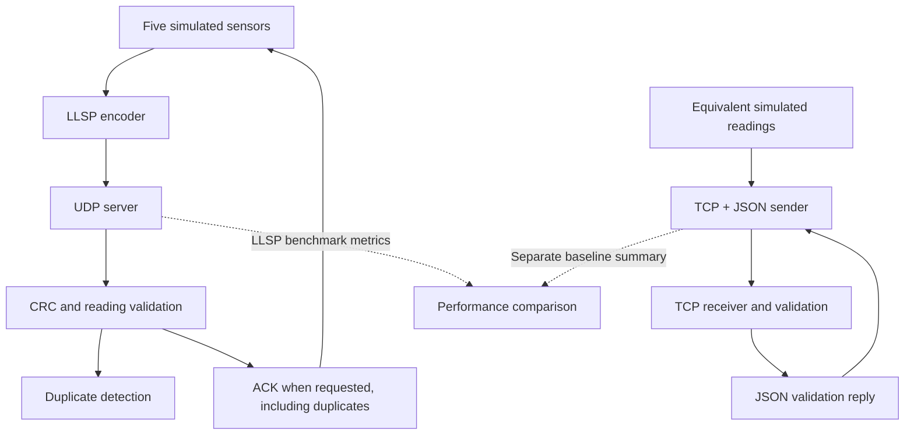

# Design and Performance Evaluation of a Custom Application-Layer Protocol for Low-Latency IoT Sensor Data Exchange

## Project Overview

This Computer Networks laboratory project uses five simulated IoT sensors to
study LLSP, a lightweight application-layer protocol over UDP. LLSP supports ACK
requests and sender retries; a separate TCP + JSON baseline exchanges equivalent
readings. Experiments investigate latency, delivery and overhead at varying
simulated loss rates. No physical hardware is used.

## Objectives

- Design and validate a compact binary sensor packet.
- Investigate delivery and latency trade-offs of optional reliability over UDP.
- Compare equivalent readings with a TCP + JSON reference.
- Evaluate message size, delivery confirmation and retries without assuming LLSP
  will outperform TCP.

## System Architecture



UDP and TCP use separate servers. The LLSP benchmark sends sensor 1 temperature
readings; the sensor demo runs all five sensors concurrently. The baseline cycles
selected sensors on one persistent TCP connection. A unified benchmark is future
work.

## Features

Implemented:

- Binary LLSP DATA (17 bytes) and ACK (8 bytes), version and CRC checking.
- Five concurrent sensors: two temperature, two humidity and one motion.
- Reliable sending with ACK timeout and up to three total attempts.
- UDP validation, duplicate detection and repeat ACKs for duplicates.
- Sender-side simulated DATA loss and CSV-producing LLSP benchmark.
- Standalone TCP + JSON server/client with framing, validation, application RTT,
  byte accounting and throughput summary.
- Automated packet-format and baseline tests.

Planned or in progress:

- Unified comparisons and finalized result schema.
- Unreliable sender CLI (the packet format/server already allow no-ACK DATA).
- Graph generation; `src/plot.py` has not been implemented.
- Heartbeat behavior (currently only a message constant).

## Project Structure

```text
PacketLab/
|-- src/
|   |-- protocol.py              # LLSP constants and binary packet/reading codec
|   |-- server.py                # UDP validation, ACKs and duplicate handling
|   |-- sensor.py                # Five concurrent reliable simulated sensors
|   |-- benchmark.py             # LLSP experiments and CSV output
|   |-- baseline_tcp_json.py     # Standalone TCP reference and reusable functions
|   `-- client.py                # Empty placeholder
|-- tests/
|   |-- test_protocol.py         # Original packet-format tests
|   `-- baseline_tcp_json_test.py # Framing, validation and loopback tests
|-- docs/PROTOCOL.md             # Wire format and implementation behavior
|-- results/
|   |-- .gitkeep
|   `-- llsp_benchmark.csv        # Existing data; not a TCP comparison
|-- requirements.txt
`-- README.md
```

## Software Requirements

- Python: validated on **Python 3.14.7**. The repository declares no minimum
  supported version or dependency pins; other versions are not verified here.
- `requirements.txt`: `pytest` and `matplotlib`. The network implementations,
  including the TCP baseline, use only the standard library.
- Git and a terminal such as Windows PowerShell.
- No physical sensors, IoT boards, MQTT broker or cloud service are required.

## Installation

Run in Windows PowerShell:

```powershell
git clone https://github.com/saradaahalya/PacketLab.git
cd PacketLab
git checkout dev
python -m venv .venv
.venv\Scripts\Activate.ps1
python -m pip install -r requirements.txt
```

Reuse an existing valid `.venv` when available. To run these additions before
their PR is merged into `dev`, check out `feature/tcp-baseline-docs` instead.
Contributors create feature branches and target PRs at `dev`; `main` is final stable.

### Other shells and activation

Windows cmd activation: `.venv\Scripts\activate.bat`. On Linux/macOS, use
`python3 -m venv .venv` and `source .venv/bin/activate`. If PowerShell blocks
activation, replace `python` below with `.venv\Scripts\python.exe`; changing
system execution policy is unnecessary.

## Execution

Run from the repository root. Activate the environment in each terminal.

### LLSP sensor demonstration

Terminal 1:

```powershell
python src/server.py
```

Terminal 2:

```powershell
python src/sensor.py
```

Both use `127.0.0.1:9999`. Stop each with Ctrl+C. The sensor script has no argparse
CLI: it always runs all five sensors and requests ACKs. It waits up to 1 second
per attempt, permits 3 total attempts (2 retries), and sleeps 2 seconds after each
reading's attempts. There is no reliable/unreliable mode flag. Flags-zero DATA
is supported by the encoder/server but needs a future fire-and-forget sender.

Optional sender-side loss in Terminal 2:

```powershell
$env:LLSP_LOSS_RATE = "0.10"
python src/sensor.py
# After stopping the simulator:
Remove-Item Env:LLSP_LOSS_RATE
```

This suppresses outgoing DATA attempts, not server-side or TCP packets.

### TCP + JSON baseline

Terminal 1 (waits up to 60 seconds between clients, stops after 100 valid messages):

```powershell
python -m src.baseline_tcp_json server --host 127.0.0.1 --port 10000 --timeout 60 --max-messages 100
```

Terminal 2:

```powershell
python -m src.baseline_tcp_json client --host 127.0.0.1 --port 10000 --count 100 --sensors 1 2 3 4 5 --seed 42
```

`--count` is total across selected sensors, sent round-robin. Select only one with
`--sensors 1`. `--seed` controls values, not wall-clock timestamps. Defaults are
loopback port 10000 and a 5-second socket timeout. With no count limit, the server
accepts repeated clients until idle accept timeout or Ctrl+C, serving one connection
at a time. Direct execution (`python src/baseline_tcp_json.py ...`) also works.

Frames are compact UTF-8 JSON plus one LF byte. Requests contain `sensor_id`,
`seq`, `sensor_type`, `value`, `timestamp_ms`. A validation reply contains `ack`,
`sensor_id`, `seq`. JSON carries the simulator's natural rounded values (for
example, `27.65`); LLSP encodes those same logical values as binary32. Both use
the same 32-bit truncation of the millisecond timestamp.

The client prints JSON summaries of sent/acknowledged messages, mean/median RTT
in milliseconds, request/reply JSON bytes, framing bytes and acknowledged messages
per second. Connection failure, timeout or invalid reply exits nonzero rather than
reporting a completed delivery result. No application retries or CSV output are
added. TCP retries are handled by the OS and are not counted here.

### LLSP benchmark

Stop the sensor simulator first. Start a **fresh** UDP server in Terminal 1:

```powershell
python src/server.py --quiet
```

Terminal 2:

```powershell
python src/benchmark.py --packets 500 --timeout 0.05 --loss-rates 0 0.05 0.10 0.20
```

This CLI is implemented, but benchmark/CSV development continues. It prints
delivery confirmation, average ACK latency, retransmissions and packet size, then
appends to `results/llsp_benchmark.csv`. `--overwrite` replaces that file; omit it
to preserve existing data. Do not commit generated experiment data without team
agreement. This runs LLSP only, not TCP. Restarting the server clears its duplicate
cache, though sequence collisions remain possible within long runs.

### Help and tests

```powershell
python src/server.py --help
python src/benchmark.py --help
python -m src.baseline_tcp_json --help
python -m src.baseline_tcp_json server --help
python -m src.baseline_tcp_json client --help
python -m pytest tests
```

## Experimental Setup

Planned loss rates are **0%, 5%, 10% and 20%**. Use equal sensor inputs, message
counts, send schedules and repeated trials; record OS/Python, hosts, timeouts,
connection reuse and logging settings. The TCP demo has no sensor simulator-style
2-second pacing, and separate random runs are not identical input datasets.
Future code can pass pre-generated readings to `baseline_tcp_json.run_client()`
and encode those same fields with the LLSP codec.

LLSP currently suppresses outgoing DATA attempts at the sender, including retry
attempts. ACKs are not deliberately impaired. The UDP server does not simulate
loss, and TCP has no equivalent impairment. These runs demonstrate LLSP retries,
**not an equal network-loss comparison with TCP**. Fair loss-resilience testing
needs an equivalent documented impairment model for both transports. No TCP
packet-loss results are supplied.

Compare application size and no-loss request/ACK timing between the transports,
with the measurement differences below stated. Present LLSP's behavior under
simulated loss as a separate result until equivalent impairment is available.

## Performance Metrics

| Metric | Definition and interpretation |
|---|---|
| LLSP `avg_latency_ms` | Successful reading's time before first attempt through matching ACK, using `perf_counter()`; includes earlier timeouts/retries, excludes failed readings |
| TCP `mean_rtt_ms`, `median_rtt_ms` | `perf_counter_ns()` before send through matching reply decoding/validation; includes server processing, excludes connection setup and request generation/serialization |
| Delivery ratio | Intended: unique valid received / logical sent messages × 100. LLSP `delivery_rate_pct` currently counts matching ACKs / logical packets, not independently observed unique server receipts |
| Retransmissions | LLSP attempts after the first, including simulated suppressed attempts; maximum 2 per reading. TCP transport retries are not measured |
| Application size | LLSP DATA 17 bytes (9 reading bytes), ACK 8 bytes. TCP counts actual UTF-8 JSON, 1-byte LF framing and reply bytes separately |
| Throughput | TCP acknowledged messages / elapsed seconds on established connection, including generation/serialization. LLSP records `elapsed_seconds` but no throughput column |

Neither timing is exact one-way latency. No unrelated-clock subtraction or RTT/2
estimate is used. LLSP retry-inclusive confirmation time and unimpaired TCP RTT
must be labelled when compared. LLSP's zero latency when none deliver is a
placeholder. Application sizes exclude Ethernet/IP/transport headers, TCP ACKs,
handshakes and transport retries; they are not total on-wire bandwidth.

## Expected Results

- The UDP server validates readings, prints decoded data and sends requested ACKs.
  Sensors report ACK receipt or delivery unconfirmed.
- Repeated `(sensor_id, seq)` pairs are labelled duplicates and ACKed again when
  requested. Without sessions/wraparound policy, restarts may cause new readings
  to be misclassified.
- TCP exchanges framed JSON and prints aggregate summaries. `--max-messages`
  permits a finite demo server to exit cleanly.
- The benchmark prints metrics and appends its CSV as described above.
- Tests pass in a correctly installed environment.

Loss can change confirmation and retry counts. These are expected behaviors, not
observed experimental findings. No latency, delivery percentage or speed advantage
is assumed in advance.

## Testing

```powershell
python -m pytest tests
python -m pytest tests/baseline_tcp_json_test.py
```

There are 10 original packet tests and 10 new baseline tests. The baseline suite
covers partial/coalesced reads, invalid/truncated/oversized JSON, reading validation,
UTF-8 size accounting, all five sensors, idle shutdown and repeated loopback
connections on ephemeral ports.

For a manual smoke test, use the TCP commands above with `--max-messages 10` on
the server and `--count 10` on the client. Both should report 10 messages
received/acknowledged and exit cleanly, with 10 request and 10 reply framing bytes.
Timing and JSON size vary with values and environment. Automated loopback tests
also verify the exchange without reserving a fixed port.

## Documentation

See [docs/PROTOCOL.md](docs/PROTOCOL.md) for wire layout, validation, reliability,
reproducible packet bytes, baseline framing and implementation limitations.

## Limitations and Future Work

- Simulated sensors/loopback tests do not establish real IoT or WAN performance.
- Duplicate keys lack session/client identity, expiry and wraparound handling;
  this is not exactly-once delivery. ACKs do not imply persistence.
- CRC and TCP reliability supply no authentication, encryption or production security.
- Sender-side loss is not equivalent to real bidirectional network impairment.
- TCP serves sequential clients; stop-and-wait application replies and
  `TCP_NODELAY` must be recorded when interpreting measurements.
- Unified comparisons, unreliable sender CLI, heartbeat semantics and graphs remain
  future work. Result format is not final, so plotting is deferred.
- Physical sensor units are not encoded or formally specified in the source.

## Team

Sarada, Siya and Nimesha.
