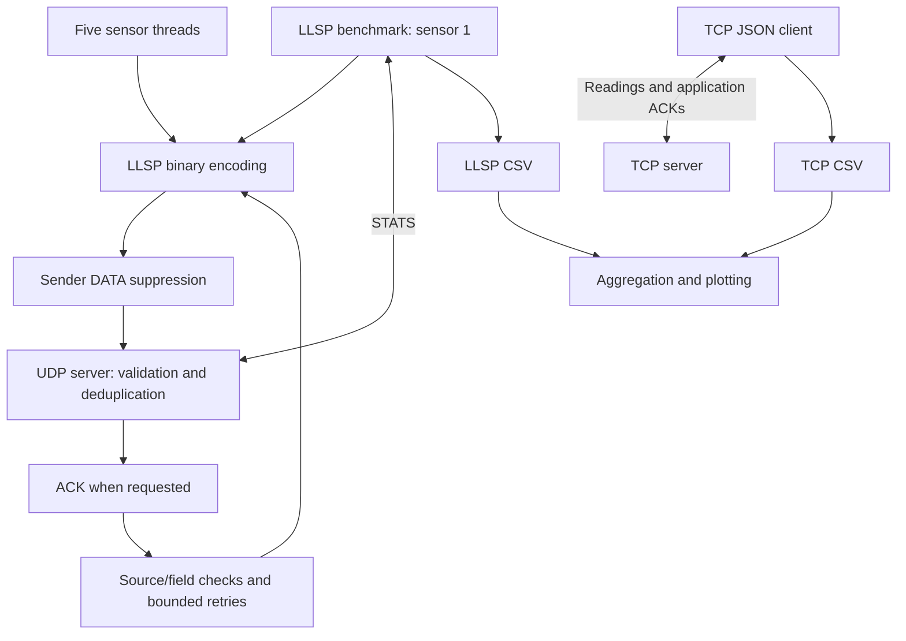

# Design and Performance Evaluation of a Custom Application-Layer Protocol for Low-Latency IoT Sensor Data Exchange

PacketLab is a Computer Networks laboratory project using five simulated IoT
sensors. LLSP carries compact binary readings over UDP with optional ACKs and
retries. A separate TCP + JSON baseline carries the same kinds of fields.
The project studies message size, receipt, confirmation time and retry cost;
it does not assume LLSP is faster or more reliable than TCP.

## Current components

```text
src/protocol.py              LLSP packet, reading and STATS codecs
src/server.py                UDP validation, ACKs and duplicate detection
src/sensor.py                Five concurrent reliable simulated sensors
src/llsp_reply.py            Source/field validation with bounded reply deadlines
src/benchmark.py             Reliable/unreliable LLSP experiments and CSV
src/baseline_tcp_json.py      TCP JSON framing, validation, metrics and CSV
src/plot.py                   CSV aggregation and four PNG graphs
src/client.py                 Empty placeholder, unused
scripts/run_final_experiments.ps1  Repeated experiments in a new output directory
tests/                        Protocol, TCP and LLSP regression tests
docs/PROTOCOL.md               Wire layout and implementation limits
results/                      Historical measured CSVs and four graphs
```



The sensor demo uses all five sensors concurrently. The LLSP benchmark uses
sensor 1 temperature readings. TCP cycles selected sensors on one connection.
The PowerShell script coordinates separate trials; it does not provide equal
network impairment or a shared identical input dataset.

## Setup

Validated with Python 3.14.7. Network code uses the standard library;
`requirements.txt` lists `pytest` and `matplotlib` without pinned versions.
Reuse the existing environment when available. For a new installation:

```powershell
python -m venv .venv
.venv\Scripts\python.exe -m pip install -r requirements.txt
```

Run commands below from the repository root with that environment activated,
or replace `python` with `.venv\Scripts\python.exe`. No hardware or cloud service
is required. Default servers bind localhost only.

## LLSP format and behavior

Multibyte fields are big-endian. The 6-byte header contains one byte combining
version/type, one flag byte, a 2-byte sensor ID and a 2-byte sequence number.
DATA adds a 9-byte reading (type, binary32 value, 32-bit millisecond timestamp)
and a 2-byte CRC: **17 bytes** total. ACK is **8 bytes**. STATS request is 8 bytes;
reply is 16 bytes, containing two unsigned 32-bit counters.

CRC uses `binascii.crc_hqx(body, 0xFFFF)` with polynomial `0x1021`. It detects
accidental corruption, not malicious messages. The server rejects bad CRC,
version, DATA lengths, sensor IDs, types and value ranges. See
[the protocol reference](docs/PROTOCOL.md) for offsets and exact validation.

IDs 1 and 2 generate temperature values 20–35; 3 and 4 humidity 30–80;
5 generates binary motion. Physical units are not encoded. Decimal readings are
rounded before binary32 conversion; small representation differences are normal.

### Sensor demonstration

Terminal 1:

```powershell
python -B src/server.py
```

Terminal 2:

```powershell
python -B src/sensor.py
```

Both use `127.0.0.1:9999`. Sensors always request ACKs, run indefinitely and sleep
2 seconds after each reading's attempts. Each reading permits **three total
attempts, at most two retransmissions**, each with a 1-second ACK deadline.
Retries reuse the exact packet. Stop with Ctrl+C.

For sender-side DATA omission in Terminal 2:

```powershell
$env:LLSP_LOSS_RATE = "0.20"
python -B src/sensor.py
# After stopping:
Remove-Item Env:LLSP_LOSS_RATE
```

Replies must come from the configured server and match type, ID, sequence,
flags and payload length. Invalid/unrelated replies are ignored within the same
deadline rather than consuming another send attempt. The deadline is not extended
by incoming junk. This validation is not authentication.

### Duplicate limitation and safe demo procedure

The receiver remembers `(sensor_id, seq)` for its entire process lifetime.
Repeated keys are ACKed again but not counted as new readings. There is no session
ID or expiry. Restarting a sensor, wrapping its 16-bit sequence, or using another
sender with the same ID can suppress a valid new reading.

**Stop senders, restart the UDP server, then start the next independent session.**
Do not restart only the sensor process. Changed timestamps, payloads or UDP source
ports cannot safely solve session identity without changing duplicate semantics.
A future version could carry an explicit session identifier; the current 17-byte
DATA and 8-byte ACK formats are unchanged.

## LLSP benchmarking

Stop all sensor simulators and start a **fresh, dedicated** server in Terminal 1:

```powershell
python -B src/server.py --quiet
```

Terminal 2, using a new temporary CSV:

```powershell
$csv = Join-Path $env:TEMP ("llsp-" + [guid]::NewGuid() + ".csv")
python -B src/benchmark.py --packets 30 --timeout 0.01 --mode both --loss-rates 0 0.20 --output $csv
```

Restart the server before another benchmark invocation. Each invocation starts
DATA sequences at zero and uses disjoint ranges for scenarios. Total logical
readings across scenarios must not exceed 65536. Nonzero initial counters or
counter changes between scenarios cause rejection. Global STATS cannot detect
all unrelated traffic, so exclusive server use remains a measurement requirement.

| Option | Default | Meaning |
|---|---|---|
| `--packets` | 500 | Logical readings per scenario |
| `--timeout` | 0.05 | Positive finite ACK/STATS timeout, seconds |
| `--mode` | both | reliable, unreliable, or both |
| `--interval` | 0.002 | Nonnegative finite delay between unreliable sends |
| `--loss-rates` | 0 .05 .10 .20 | DATA send omission probabilities |
| `--output` | results/llsp_benchmark.csv | CSV path; use a new path |
| `--overwrite` | off | Explicitly replace chosen CSV; avoid historical files |

Reliable mode sends with ACK requests and up to three attempts. Unreliable mode
sends once without ACK waiting/retries. STATS is queried before and after each
scenario with correlated replies and three bounded query attempts.

### Metrics and CSV compatibility

- `delivered` / `delivery_rate_pct`: new unique receiver keys divided by logical
  readings, in **both modes**. Duplicates are reported separately, never added.
- `ack_confirmed` / `ack_confirmation_rate_pct`: reliable readings with a matching
  ACK, separately reported; blank in unreliable mode. Receipt can exceed confirmed
  delivery when ACKs are lost.
- `server_unique`, `server_duplicates`: receiver counter deltas. Detectably
  inconsistent deltas abort the invocation without writing its rows; no clamping.
- `transmitted_readings`: distinct logical readings for which at least one actual
  `sendto` occurred, excluding readings whose every attempt was suppressed.
- `avg_latency_ms`: mean time before first attempt through matching ACK, including
  earlier timeouts/retries, only for confirmed readings. Blank if not measured;
  summaries show N/A. It is not one-way latency.
- `retransmissions`: attempts after the first, including suppressed attempts.
- `avg_packet_size_bytes`: LLSP application DATA bytes, always 17 for this payload.
- `elapsed_seconds`: scenario duration rounded to two decimal places; no LLSP
  throughput column is supplied.

Historical CSVs have no ACK/transmitted columns. Historically reliable delivery
counted ACKs and unreliable delivery counted unique plus duplicate arrivals.
Stored rows have zero duplicates and matching unique/delivered values, so their
recorded delivery averages remain valid for those runs. New rows use clarified
receipt semantics and must go into a new CSV; incompatible headers are rejected.
Plots can read both schemas. Do not mix different packet counts/timeouts into one
plot input: grouping uses loss and mode only.

## TCP + JSON baseline

Terminal 1:

```powershell
python -B -m src.baseline_tcp_json server --timeout 60 --max-messages 10
```

Terminal 2:

```powershell
python -B -m src.baseline_tcp_json client --count 10 --sensors 1 2 3 4 5 --seed 42
```

Default endpoint is `127.0.0.1:10000`. `--count` is total across selected sensors.
Client options include `--host`, `--port`, `--timeout`, `--count`, `--sensors`,
`--seed`, and optional `--csv PATH` to append a completed run. Use a new CSV path.
Server options include `--host`, `--port`, `--timeout`, `--max-messages`.
Default timeout is 5 seconds; the example extends it for classroom startup.

Readings use exactly `sensor_id`, `seq`, `sensor_type`, `value`, `timestamp_ms`.
Compact UTF-8 JSON is followed by one LF byte. Buffered framing handles split
and combined reads, with a 4096-byte JSON frame limit. Invalid JSON/schema closes
that connection; the server can accept another client. Connections are served
sequentially with `TCP_NODELAY`. TCP supplies reliable ordered bytes; there are
no application retransmissions or persistent storage.

The client prints mean/median application RTT, byte counts, elapsed time and
acknowledged messages/second. RTT excludes connection setup and request generation/
serialization; elapsed throughput includes generation/serialization. Failures exit
nonzero without a completed result CSV row. TCP transport retries are not counted.

## Safe repeated experiments and graphs

```powershell
.\scripts\run_final_experiments.ps1 -Runs 2 -Packets 30
```

Defaults are five runs and 500 messages per scenario. Each run starts a fresh UDP
server, runs eight LLSP scenarios, then a TCP server/client trial. Output defaults
to a unique directory under the operating system temporary directory. An explicit
`-OutputDirectory` is supported **only if that directory does not already exist**:

```powershell
$out = Join-Path $env:TEMP ("PacketLab-review-" + [guid]::NewGuid())
.\scripts\run_final_experiments.ps1 -Runs 2 -Packets 30 -OutputDirectory $out
```

CSV files, four graphs, server logs and the plotting cache stay in that directory.
The script checks ports, waits for its server's startup banner, checks exits and
stops only processes it started. It never deletes historical CSVs or graphs. Stop
other servers before running it. Port preflight cannot prevent every external
race; run on a dedicated local setup.

For standalone plotting, choose a new graph output directory:

```powershell
python -B src/plot.py --llsp results/llsp_benchmark.csv --tcp results/tcp_baseline.csv --output-dir "$env:TEMP/PacketLab-review-graphs"
```

Graph names: `delivery_vs_loss.png`, `latency_vs_loss.png`,
`retransmissions_vs_loss.png`, `packet_size.png`. Plotting exports PNGs without a
GUI dependency. Means and sample standard deviations are calculated across trials;
error bars are standard deviations, not confidence intervals. The TCP latency line
is an **unimpaired reference**, not a TCP loss experiment. Direct plotting replaces
same-named PNGs in its selected directory; use a fresh directory to preserve them.

## Interpretation and limitations

Loss simulation skips outgoing LLSP DATA attempts before sending, including retries.
It does not impair ACKs, UDP reception, or TCP. These are application omission
experiments, not equal bidirectional network-loss comparisons. Separate random
inputs and send schedules also limit direct timing comparisons. LLSP supports no
CLI random seed; TCP seed controls values but not timestamps.

Application size excludes TCP/UDP/IP/Ethernet headers, transport ACKs, handshakes
and retransmitted network traffic. Smaller LLSP DATA does not prove faster overall
performance or lower total bandwidth. Loopback trials do not establish hardware,
WAN, energy, security or production behavior. ACKs do not imply persistence.
Heartbeat semantics, generic client, session identity and equivalent network
impairment remain future work.

## Tests

```powershell
python -B -m pytest -p no:cacheprovider tests
```

There are 44 collected cases: 12 protocol, 12 TCP baseline and 20 LLSP/plot/script
regressions (including parameterized cases). Windows script checks skip on other
platforms; busy-port coverage may skip when that port is already occupied.
Tests use localhost, temporary outputs, bounded waits and process cleanup.
Coverage includes CRC/framing, duplicates and restart limitations, counter
accounting, ACK confirmation versus receipt, reply validation, retry limits,
five sensors, historical CSV plotting, output preservation and port conflicts.

Team: Sarada, Siya and Nimesha.
